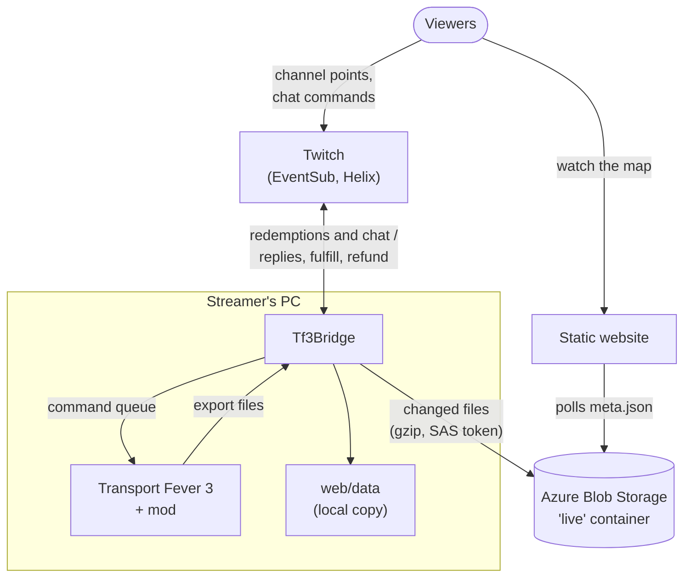

# TF3 Twitch Integration

Let your Twitch viewers watch and play along with your **Transport Fever 3** game.

The project has three parts:

- **a game mod** (`lua_mod/`) that exports the live game state and carries out viewers' actions,
- **Tf3Bridge** (`middle_app/`), a small Windows app that runs next to the game, talks to Twitch and publishes the data,
- **a static website** (`web/`) with a live map of your world: towns, industries, stations, lines and moving vehicles.

Viewers browse the map on the website, buy towns and industries, boost or sabotage them with **channel points**, and ask the chat bot about the game. Chat commands only *read* the game; the game itself changes only through channel points rewards, which you control (costs, cooldowns, limits).

**Twitch and Azure are optional.** On their own, the mod, Tf3Bridge and the website run entirely on your PC as a live companion map of your game in the browser: no accounts, no cloud. Add Twitch for viewer interaction and Azure to put the website online.

The interfaces of Tf3Bridge and the website are in **English and Polish**.

## How it works



**Game → website**

1. The mod collects the game state on the GUI thread, spread over frames so the game doesn't stutter: a dynamic snapshot (towns, industries, stations, lines, vehicles with positions, company finances, active effects) every couple of game days, the street and track network as a full dump plus diffs after every build, and a terrain heightmap. It writes them with `app.saveUserdata`, the only file access a TF3 mod has.
2. Tf3Bridge polls that folder, assembles the network from dumps and diffs, renders the terrain images and publishes ready-made JSON files (`latest/meta.json`, `dynamic.json`, `network.json`, …) to `web/data/` locally.
3. If Azure is enabled, Tf3Bridge mirrors every changed file to a public, read-only Blob Storage container (gzipped, `meta.json` last).
4. The website is plain static files. Every few seconds it fetches the small `meta.json` and downloads the rest only when the data changed. There is no server code anywhere.

**Twitch → game**

1. Tf3Bridge logs in as the streamer and listens to Twitch EventSub over WebSocket: chat messages and channel points redemptions. No public server or webhook is needed.
2. A redemption is matched to a game object (the viewer types a town, industry or line name, a viewer's nick, or a build code copied from the website) and turned into a command in a queue file the mod reads every second.
3. The mod executes the command through the game API and writes the result back. Tf3Bridge then marks the redemption as fulfilled, or cancels it so Twitch refunds the points, and replies in chat with a link to the object on the website. Fulfilled rewards also pop up as an in-game notification.
4. Rewards are enabled on Twitch only while the game is running with the mod, so viewers can't spend points on a paused or closed game.

More detail: [docs/architecture.md](docs/architecture.md), [docs/twitch-channel-points.md](docs/twitch-channel-points.md).

## Features

### Website

- A live map of the street and track network on a shaded terrain relief, with vehicles moving along their lines. Pan and zoom, also on touch screens.
- Lists and details for towns, industries, stations and lines, an **Owners** tab with each viewer's estate and a **Company** tab with your finances and history charts.
- Badges for active viewer effects (boosts, strikes, stopped lines…) with their end date in game time.
- A build tool that lets viewers pick a spot for a new town or industry and copy a code for the reward. It checks the same rules as Tf3Bridge (distances, water, slopes, terrain regions per industry type).
- Shareable links to any object (`#town=…`, `#line=…`, `#owner=…`), an optional Twitch mini player, and an English/Polish switch.

### Channel points rewards

Tf3Bridge creates and manages the rewards on your channel. Each one can be disabled and balanced in the **Rewards…** window (cost, cooldown, limits, duration in game months, strength).

| Group | Rewards |
|---|---|
| Ownership | buy a town, buy an industry (the object gets the viewer's name: `Kraków \| viewer`) |
| Building | new town, new industry (at a spot chosen on the website) |
| Boosts | town boost, industry boost, premium fuel for a line |
| Sabotage (other viewers' objects only) | industry strike, tax raid, watered-down fuel, brake sabotage |
| Line control | stop a line, make a line wait at stations |
| Company | subsidy, loan |

You can also add rewards you carry out yourself; Tf3Bridge enables and disables them together with the game. The full list with all rules: [middle_app/README.md](middle_app/README.md#channel-points-rewards).

### Chat commands

Informational only, answered by Tf3Bridge as the streamer. Each command also has a Polish name (`!mapa`, `!majatek`, …).

`!help`, `!map`, `!assets [viewer]`, `!town <name>`, `!industry <name>`, `!line <name>`, `!ranking`, `!free [towns|industries]`, `!date`, `!company`, `!best [line|company]`, `!worst [line|company]`

Details and cooldowns: [middle_app/README.md](middle_app/README.md#chat-commands).

## Requirements

For the local setup:

- **Transport Fever 3** (Steam) on **Windows**.
- **Tf3Bridge**: the published exe is self-contained and needs no .NET install. To build it you need the **.NET 9 SDK** (Windows, WinForms).
- **Python 3** to extract the game icons for the website.

Only for the optional parts:

- **Twitch**: any account works for chat commands; channel points rewards need **Affiliate or Partner** status.
- **Public website**: an **Azure** subscription with a Storage account (for the data) and, optionally, a Static Web App (for the site), plus the Azure CLI and Node.js. The setup is designed to be close to free: a few MB of blob data, pennies a month in writes, and Static Web Apps' Free plan. Check current Azure pricing before you deploy.

## Local setup

Everything in this section runs on your PC. At the end you have a live map of your game at http://localhost:5080.

### 1. Build and start Tf3Bridge

```powershell
.\infra\publish.ps1
```

This builds a self-contained `middle_app\dist\Tf3Bridge.exe` and creates a desktop shortcut. During development you can also run it from source:

```bash
cd middle_app/src/Tf3Bridge
dotnet run
```

The app finds your Steam folder and the TF3 user data on its own. Inside your checkout it publishes the data to `web/data/` and serves the website at http://localhost:5080.

### 2. Enable the mod in the game

Nothing to copy: Tf3Bridge carries the mod inside the exe and installs or updates it in TF3's `staging_area` at every start. Enable **TF3 Data Export** when you create or load a game.

To install the mod without Tf3Bridge, build a zip with `lua_mod\pack.ps1` (see [lua_mod/README.md](lua_mod/README.md)).

Start the game. Within a few seconds Tf3Bridge shows the first publish. The **Mod settings…** button sets how often the mod exports and whether it includes vehicles and terrain.

### 3. Extract the game icons

Vehicle, cargo and station icons are Urban Games artwork, so they aren't in the repository. Extract them from your own game install once after cloning and after game updates:

```powershell
python tools\extract_game_icons.py "<path to Transport Fever 3>"
```

Without an argument the script uses the `TF3_GAME_DIR` environment variable or the default Steam library.

### 4. Open the website

Click **Website** in Tf3Bridge or open http://localhost:5080. Tf3Bridge serves `web/` itself while it runs; the port is `Bridge:WebPort` in `appsettings.json` (0 turns it off).

Without Tf3Bridge, `.\web\serve.ps1` serves the same folder, and any other static file server pointed at `web/` works too. Opening `index.html` straight from disk doesn't, because browsers block `fetch` from `file://`.

Optionally give the site a name and logo: copy `web/site.example.json` to `web/site.json` and set `title` and `logo` (see [Website settings](#website-settings)).

## Optional: Twitch

In Tf3Bridge click **Twitch…** → **Log in with Twitch**. The app shows a code and opens `twitch.tv/activate`, where you approve access (device code flow, no password ever goes through the app). The tokens are stored encrypted for your Windows account.

Once logged in, Tf3Bridge connects to EventSub and answers chat commands. On an Affiliate/Partner channel it also creates the channel points rewards; tune them in **Rewards…**. The rewards are enabled only while the game is running with the mod.

Chat replies and reward descriptions can link to your website. Set its address in `middle_app/src/Tf3Bridge/appsettings.Local.json` (gitignored, copied next to the exe by `publish.ps1`):

```json
{ "Twitch": { "SiteUrl": "https://your-site.example/" } }
```

## Optional: public website

To let viewers open the map, the data goes to cloud storage and the website to a static host.

### Storage backends

| Backend | Status |
|---|---|
| Azure Blob Storage | supported |
| S3-compatible storage | planned |

### Azure Blob Storage

```powershell
winget install Microsoft.AzureCLI
.\infra\azure-setup.ps1 -Name <storageaccount>
```

The account name is 3–24 lower-case letters and digits and must be unique in Azure. The script creates a resource group, a Storage account with a public read-only `live` container and CORS, and prints the container URL and a write-only SAS token valid for a year (`-SasOnly` issues a new one later).

In Tf3Bridge click **Azure…**, paste the URL and the token, **Test connection**, **Save**. From now on every change is mirrored to the container; the local copy in `web/data/` keeps working.

### Website settings

Copy the template and fill in your values:

```powershell
Copy-Item web\site.example.json web\site.json
```

| Field | Meaning |
|---|---|
| `title` | site name in the top bar and the browser tab (default "TF3 Live") |
| `logo` | an image before the name; put it in `web/img/site/` (e.g. `img/site/logo.png`); empty = no logo |
| `twitchUrl` | optional, `https://www.twitch.tv/<channel>`; the stream button and mini player only appear when it's set |
| `dataUrl` | where the site reads the data when not on localhost: `https://<storageaccount>.blob.core.windows.net/live/latest/` |

Both `web/site.json` and `web/img/site/` are gitignored, so your branding stays out of the repository. On localhost the site always reads `web/data/`; to test the cloud data locally, open `http://localhost:5080/?data=<dataUrl>`.

### Deploying the website

Deploy to **Azure Static Web Apps** (create a Static Web App in the Azure portal first, then copy its deployment token from **Overview → Manage deployment token**):

```powershell
.\infra\deploy-web.ps1 -DeployToken "<token>"   # first time, the token is remembered encrypted
.\infra\deploy-web.ps1                          # next times
```

Alternatively, host the site as a Storage account static website with `-Target storage`. The script refuses to deploy without the game icons (local setup, step 3). Details: [web/README.md](web/README.md#deploying-to-azure).

`.\infra\make_all.ps1` does a full release in one go: publish Tf3Bridge, zip it and deploy the website.

## For forks and developers

### Use your own Twitch application

Tf3Bridge is a public Twitch client (no client secret). The Client ID in `middle_app/src/Tf3Bridge/appsettings.json` belongs to this project's Twitch application. If you distribute your own build, register your own application at [dev.twitch.tv](https://dev.twitch.tv/console) as a **Public** client and put its Client ID in `appsettings.Local.json`:

```json
{ "Twitch": { "ClientId": "<your client id>", "SiteUrl": "https://your-site.example/" } }
```

Note that Twitch only lets the application that created a reward change it, so rewards created under one Client ID can't be managed under another.

### Repository layout

```
lua_mod/       the TF3 mod (Lua 5.2): export, commands, timed effects, in-game notifications
middle_app/    Tf3Bridge (.NET 9, WinForms) and its xUnit tests
web/           the static website (HTML, CSS, JS modules, no build step)
infra/         PowerShell scripts: Azure setup, publishing, website deployment, notification icon
tools/         extract_game_icons.py
docs/          design notes and findings about the TF3 modding API
```

Each part has its own README with the details: [lua_mod](lua_mod/README.md), [middle_app](middle_app/README.md), [web](web/README.md). The [docs index](docs/README.md) lists the design notes.

### Running the tests

```bash
cd middle_app
dotnet test
```

Twitch can be tested without a live channel: **Test actions…** in Tf3Bridge simulates reward redemptions, and the Twitch CLI's EventSub test server is supported too ([middle_app/README.md](middle_app/README.md#chat-commands)).

### Translations

Tf3Bridge and the website currently speak English and Polish. Translations into other languages are welcome; see [middle_app/README.md](middle_app/README.md#language) and `web/js/i18n.js` for where the texts live.

## License and trademarks

The code is released under the [MIT License](LICENSE).

Transport Fever 3 is a trademark of Urban Games. No game assets are included in this repository; the icons are extracted from your own copy of the game. Twitch and the Twitch logo are trademarks of Twitch Interactive, Inc.; the logo is used as the icon of the in-game reward notification, in line with the Twitch brand guidelines. This project is not affiliated with or endorsed by Urban Games or Twitch.
